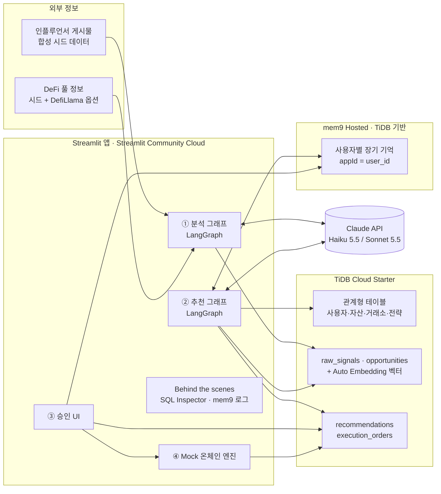
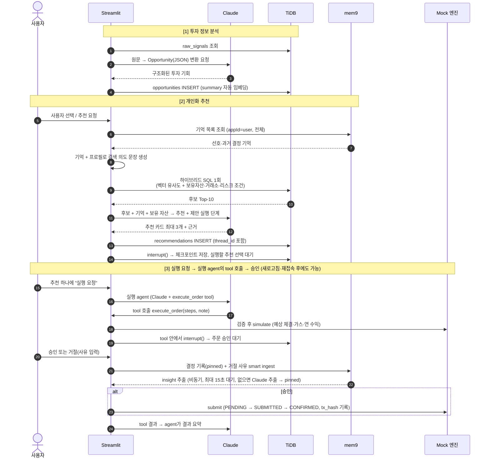
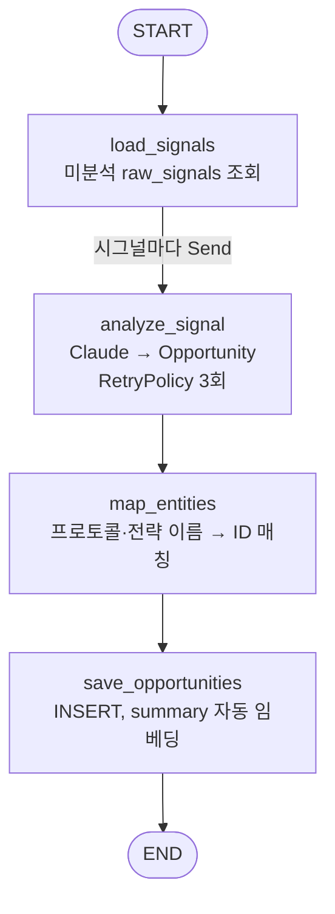
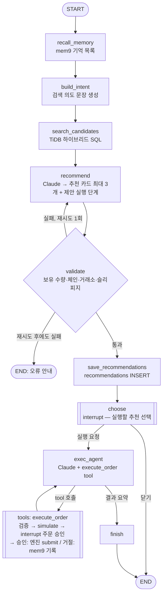

# TiDB + mem9 기반 AI 투자 추천 E2E 데모 — 아키텍처 문서

> 버전 2.0 · 2026-10-29 (한·영 전환, Google 로그인, 접속·사용 기록, 배포 준비)
> 상태: 확정 (구현 착수 기준 문서)

---

## 0. 요약

이 데모가 보여주는 AI 서비스 흐름은 다음과 같습니다.

1. 외부 인플루언서·DeFi 투자 정보를 AI가 수집·분석
2. 사용자별 보유 자산·거래소 환경에 맞는 투자 기회 추천
3. 사용자 승인 후 기존 자동화 엔진으로 실행

### 0.1 데모 시나리오의 전제

- **가정한 서비스**: 국내·해외 거래소 계정을 연동해 사용자의 가상자산을 모아 보는 서비스가, AI 추천과 실행 기능을 붙이는 상황을 가정합니다.
- **설계 원칙**
  - **CEX 중심 데이터**: 국내 4곳·해외 4곳 거래소, 거래소 예치·스테이킹 상품, XRP·KAIA를 넣었습니다. 자산이 거래소 계정에 있는 경우를 기본으로 봅니다.
  - **두 경로를 받는 엔진**: 같은 `execute_order` tool이 거래소 계정 안의 주문(거래소 API 경로)과 온체인 주문을 모두 받습니다. 연동할 엔진이 어느 방식이어도 같은 구조로 붙일 수 있습니다.
  - **해외 계좌 신고 참고 장면**: 해외 거래소 월말 잔고를 TiDB에서 집계해, 해외 계좌 신고 기준(월말 합계 5억 원)과의 거리를 대시보드와 승인 화면에 **참고 정보로만** 보여줍니다. 계산은 SQL이 하고 LLM은 관여하지 않으며, 판단은 세무 전문가에게 맡긴다고 명시합니다.
  - **사람 승인**: AI는 제안만 하고, 실행은 사람이 승인해야 합니다.
- **규제 참고**: 개인 맞춤 투자 추천은 지역에 따라 투자자문 규제 대상이 될 수 있습니다. 실서비스로 옮길 때는 법률 검토가 필요하며, 이 문서는 그 판단을 하지 않습니다.

이 데모는 위 흐름 전체를 **하나의 Streamlit 앱**에서 End-to-End로 보여줍니다. 핵심 메시지는 다음 두 가지입니다.

- **TiDB**: 투자 정보·사용자 자산·거래소·전략 데이터와 벡터 임베딩을 **하나의 DB, 하나의 SQL**로 다룹니다. 별도 벡터 DB나 임베딩 파이프라인이 필요 없습니다.
- **mem9**: 사용자의 과거 추천 이력·선호·거절 사유를 **세션을 넘어 기억**하고, 다음 추천에 반영합니다. mem9 자체도 TiDB 위에서 동작하므로 **데이터와 기억이 같은 기술 스택**에 있습니다.

| 구성 요소 | 선택 | 비용 |
|---|---|---|
| UI | Streamlit → Streamlit Community Cloud 배포 | 무료 |
| 데이터베이스 | TiDB Cloud Starter (AWS 리전) | 무료 티어 |
| AI 장기 기억 | mem9 Hosted (`api.mem9.ai`) | 무료 시작 |
| LLM | Claude API (LangChain `ChatAnthropic` 경유) — 기본 `claude-haiku-5-5`, 시연용 옵션 `claude-sonnet-5-5` | Haiku 기준 데모 전체 $1 미만 |
| 워크플로 | LangGraph — 분석 그래프 + 추천·승인 그래프. 추천은 `interrupt()`로 사람 승인 대기, 체크포인트는 TiDB에 저장 | 오픈소스 |
| 추적 (선택) | LangSmith — 노드별 프롬프트·응답·토큰 확인 | 무료 개발자 티어 |
| 실행 엔진 | 앱 내 Mock 엔진 (거래소 API·온체인 두 경로 시뮬레이션) | — |

---

## 1. 기술 구성 요소 이해 (처음 접하는 분을 위한 설명)

### 1.1 TiDB Cloud Starter

- **무엇인가**: PingCAP의 분산 SQL 데이터베이스 TiDB의 서버리스 버전입니다(구 명칭 TiDB Serverless). **MySQL과 호환**되므로 MySQL 드라이버와 SQL을 그대로 씁니다.
- **이 데모에서 쓰는 기능**
  - 일반 관계형 테이블 (사용자, 자산, 거래소, 전략 등)
  - `VECTOR(n)` 타입과 벡터 인덱스 → 유사도 검색
  - **Auto Embedding**: 텍스트 컬럼에서 벡터 컬럼을 DB가 자동 생성합니다. 외부 임베딩 API 키가 필요 없습니다.
- **Auto Embedding 동작 방식**

```sql
-- 1) 테이블 정의: 벡터 컬럼을 "생성 컬럼"으로 선언
CREATE TABLE sample (
  id        INT PRIMARY KEY,
  content   TEXT,
  embedding VECTOR(1024) GENERATED ALWAYS AS (EMBED_TEXT(
              "tidbcloud_free/cohere/embed-multilingual-v3",
              content,
              '{"input_type": "search_document", "input_type@search": "search_query"}'
            )) STORED,
  VECTOR INDEX ((VEC_COSINE_DISTANCE(embedding)))
);

-- 2) INSERT 하면 embedding은 DB가 자동으로 채움
INSERT INTO sample (id, content) VALUES (1, '스테이블코인 렌딩 수익률 상승');

-- 3) 검색도 벡터가 아닌 "텍스트"로 바로 질의
SELECT id, content
FROM sample
ORDER BY VEC_EMBED_COSINE_DISTANCE(embedding, '안정적인 이자 수익')
LIMIT 3;
```

- **모델 선택**: 한국어 콘텐츠를 다루므로 **`tidbcloud_free/cohere/embed-multilingual-v3`** (1024차원, 100개 이상 언어 지원, 무료)를 사용합니다.
  - 제약: 입력 최대 512토큰 / 2,048자 → 긴 원문 대신 **요약 필드**를 임베딩합니다.
  - 제약: Auto Embedding은 **AWS 리전의 Starter 인스턴스에서만** 지원됩니다.

### 1.2 mem9

- **무엇인가**: PingCAP이 만든 **AI 에이전트용 장기 기억 레이어**입니다. 대화나 이벤트에서 "기억할 만한 사실"을 추출해 저장하고, 나중에 다시 돌려줍니다.
- **내부 구조**: Go로 만든 REST 서버(`mnemo-server`)이고, 저장소로 **TiDB Cloud Starter**를 사용합니다.
- **이 데모에서는 Hosted 버전**(`https://api.mem9.ai`)을 사용합니다. 설치·운영할 것이 없고, 나중에 직접 운영(Self-host)으로 바꿔도 **URL과 API 키만 변경**하면 됩니다.
- **핵심 API** (헤더 `X-API-Key: <키>`)

| 용도 | 메서드 / 경로 | 주요 파라미터 |
|---|---|---|
| API 키 발급 | `POST /v1alpha1/mem9s` | 없음 → 응답의 `id`가 API 키 |
| 키 상태 확인 | `GET /v1alpha2/status` | — |
| 기억 쓰기 | `POST /v1alpha2/mem9s/memories` | `content` 또는 `messages`(둘 중 하나), `appId`, `memory_type`, `tags`, `metadata`, `mode`(`smart`/`raw`), `sync` |
| 기억 목록·검색 | `GET /v1alpha2/mem9s/memories` | `appId`, `memory_type`(`insight`/`pinned`/`session`), `tags`, `limit`, `q` |
| 단건 조회/수정/삭제 | `GET/PUT/DELETE /v1alpha2/mem9s/memories/{id}` | — |

- **두 가지 쓰기 방식**
  - `content`: 이미 정리된 사실을 그대로 저장 (예: "레버리지 상품을 원하지 않음"). `memory_type: pinned`로 저장해 고정 기억으로 둡니다.
  - `messages` + `mode: smart`: 대화 내용을 넘기면 **mem9가 LLM으로 사실(`insight`)을 추출하고, 기존 기억과 비교해 중복·충돌을 조정**합니다. 이것이 단순 로그 저장과 다른 점입니다. 원문은 `session` 타입으로 함께 저장됩니다.
- **Hosted API에서 확인한 동작** (2026-10-29 스모크 테스트, 설계에 반영)

| 항목 | 확인 결과 | 설계 반영 |
|---|---|---|
| `q` 검색 | 의미 검색이 아니라 **단어 일치에 가까움**. "risk tolerance"로 "volatile products" 기억을 못 찾고, 한국어는 조사가 붙으면("변동성이") "변동성"으로 못 찾음 | 추천 시 `q`를 쓰지 않고 **사용자 기억 전체를 목록으로** 가져와 Claude에 넘김 (사용자당 기억 수십 건 규모라 충분) |
| `content` 쓰기 | `memory_type`은 **`pinned`만 허용** (`insight`는 400, API 문서와 다름) | 앱이 직접 쓰는 기억은 모두 `pinned` |
| smart ingest | **비동기**(202)로 처리, 보통 **3–25초** 안에 `insight` 추출 | 거절 후 최대 30초 기다리며 화면에 진행 표시 |
| smart ingest 입력 형식 | 한국어 assistant 메시지(추천 문장)를 함께 보내면 **추출되지 않음** (3회 중 3회). **사용자 발화만** 보내면 추출됨 | 거절 사유(사용자 발화)만 보내고, 어떤 상품인지는 별도 `pinned` 결정 기록으로 남김 |
| 추출 언어 | 한국어로 말해도 `insight`는 **영어로 저장**됨 (예: "Rejects investment products with high volatility") | Claude가 영어 기억을 그대로 이해하고, 화면에는 한국어로 풀어 표시 |
| 추출 안정성 | 같은 조건에서도 추출되지 않는 경우가 있음 | 15초 안에 `insight`가 없으면 Claude로 사실을 추출해 `pinned`로 저장 (대체 경로) |
| 결정 기록 순서 | 사유가 담긴 결정 기록(pinned)을 **먼저** 저장하면, 영어 모드에서 추출이 연속 2회 일어나지 않음. 결정 기록과 사유 문장이 거의 같아 mem9가 기존 기억과 겹치는 내용으로 본 것으로 추정 | 사유 ingest → 추출 대기 → 결정 기록 순서로 바꿈. 바꾼 뒤 영어 1회·한국어 1회 모두 추출됨 (원인은 추정, 반복 검증은 아직) |

- **Python SDK가 없으므로** `httpx`로 얇은 클라이언트(`core/mem9_client.py`)를 직접 작성했습니다. 모든 호출을 기록해 Behind the scenes 화면에 보여줍니다.

### 1.3 Claude API (LangChain 경유)

- 모델 호출은 **LangChain의 `langchain-anthropic` 패키지(`ChatAnthropic`)** 로 합니다. 모든 호출은 `core/llm.py` 한 파일에 모아 두고, 나머지 코드는 이 파일의 함수만 사용합니다.
- **LangChain을 쓰는 이유**
  - LangGraph의 `stream_mode="messages"`로 **토큰 단위 스트리밍**이 바로 됩니다 → 추천 근거가 Streamlit 화면에 실시간으로 나타납니다.
  - 환경변수만 설정하면 **LangSmith**로 그래프 노드별 프롬프트·응답·토큰을 추적할 수 있습니다.
  - LangChain 생태계를 이미 쓰거나 다른 모델과 비교하고 싶을 때 `init_chat_model`로 교체가 쉽습니다.
- **Structured Output**: `llm.with_structured_output(Opportunity)`처럼 Pydantic 모델을 넘겨 결과를 객체로 받습니다. Claude API의 네이티브 structured output(스키마 준수를 API가 보장)을 쓰는 방식(`method="json_schema"`)을 우선 사용합니다. 실행 엔진에 넘길 명령의 형식이 깨지지 않아야 하기 때문입니다.
- **모델**: 기본 `claude-haiku-5-5`(입력 $0.10 / 출력 $0.50, 100만 토큰당). 시연 당일 품질을 높이고 싶으면 `LLM_MODEL=claude-sonnet-5-5`로 설정만 바꿉니다($2 / $10).
- **비용 절감 설정**: `effort = "low"`로 내부 추론량을 줄이고, 고정된 시스템 프롬프트에는 `cache_control`을 붙여 prompt caching을 적용합니다.
- **확인 결과** (2026-10-29 스모크 테스트, `langchain-anthropic` 1.7.7): 네이티브 structured output(도구 호출 방식으로 대체되지 않음), `effort`(`output_config`로 전달), prompt caching(2회차 캐시 읽기 확인), 스트리밍이 모두 동작합니다. 앞으로 지원되지 않는 기능이 생기면 `core/llm.py` 안에서 해당 호출만 공식 `anthropic` SDK(`client.messages.parse()`)로 처리합니다. 호출부는 바뀌지 않습니다.

```python
# core/llm.py (개요)
from langchain_anthropic import ChatAnthropic

def get_llm(**overrides):
    return ChatAnthropic(model=settings.LLM_MODEL, max_tokens=4096, **overrides)

def structured(schema, **overrides):
    return get_llm(**overrides).with_structured_output(schema, method="json_schema")
```

### 1.4 LangGraph

- **무엇인가**: LLM 워크플로를 **노드와 엣지로 구성된 그래프**로 정의하고 실행하는 오픈소스 라이브러리입니다. LangChain 팀이 만들었고, 이 데모에서는 노드 안의 모델 호출을 LangChain `ChatAnthropic`으로 합니다(1.3 참고).
- **그래프 2개로 전체 흐름을 구성합니다** (상세는 2.4)
  - `analysis_graph`: 원문 시그널 → 투자 기회. 승인이 없으므로 체크포인터를 쓰지 않습니다.
  - `recommend_graph`: 추천 → 승인 → 실행. 체크포인터를 씁니다.
- **분석 그래프에서 쓰는 기능**
  - **`Send` (병렬 분기)**: 시그널마다 분석 노드를 동시에 실행하고 결과를 모읍니다. 동시 실행 수는 `max_concurrency`로 제한해 API 속도 제한을 지킵니다.
  - **`RetryPolicy`**: LLM 호출 실패 시 노드 단위로 자동 재시도합니다.
- **추천 그래프에서 쓰는 기능**
  - **`interrupt()` (사람 대기)**: 두 곳에서 멈춥니다. 추천 카드를 보여주고 실행할 추천을 고를 때(`choose` 노드), 그리고 실행 agent가 엔진 API tool(`execute_order`)을 호출했을 때 **tool 안에서** 주문 승인을 기다릴 때입니다. 사용자가 고르거나 승인·거절하면 `Command(resume=...)`으로 **멈춘 지점부터 이어서** 실행합니다.
  - **tool 호출 (`ToolNode`)**: 실행 agent(Claude)가 실행 엔진 API를 tool로 호출합니다. 상세는 2.4.2.
  - **체크포인트**: 노드가 끝날 때마다 그래프 상태를 저장합니다. 저장소를 **TiDB**로 지정하므로 브라우저를 새로고침하거나 앱이 재시작되거나 다른 기기에서 접속해도 **승인 대기 건이 그대로 남아 있습니다.**
- **실행 단위**: 추천 요청 1회 = LangGraph **스레드 1개**(`thread_id = "rec_<uuid>"`). 이 ID를 `recommendations.thread_id`에 저장해 두고, 이 값으로 대기 중인 그래프를 다시 불러옵니다.
- **체크포인터: 직접 작성한 `TiDBSaver`** (`core/checkpoint_tidb.py`)
  - 커뮤니티 패키지 `langgraph-checkpoint-mysql`은 TiDB에서 쓸 수 없음을 스모크 테스트로 확인했습니다. 테이블 생성의 `DEFAULT ('{}')`, 체크포인트를 읽는 핵심 쿼리의 `JSON_TABLE`, 저장 쿼리의 `INSERT ... AS new`가 모두 TiDB에서 문법 오류입니다.
  - `TiDBSaver`는 LangGraph 기본 `InMemorySaver`와 같은 저장 구조를 TiDB 테이블 3개(`lg_checkpoints`, `lg_checkpoint_blobs`, `lg_checkpoint_writes`)로 옮겼습니다. 일반 `SELECT`와 `INSERT ... ON DUPLICATE KEY UPDATE`만 씁니다.
  - 연결 하나를 잠금(Lock)으로 보호해 재사용하고, 연결이 끊기면 새로 연결해 한 번 재시도합니다. 모든 쓰기가 중복 실행에 안전해서 재시도해도 문제가 없습니다.
  - `lg_checkpoints`에는 `step`, `source`, `created_at` 컬럼을 따로 두어 Behind the scenes 화면에서 SQL로 바로 조회할 수 있습니다.
  - **측정값** (Tokyo 리전, 왕복 약 40ms): 노드 2개짜리 그래프에서 승인 대기까지 0.55초, 이어서 실행 0.47초. 새 TLS 연결은 1.3초라서 연결은 앱 전체에서 하나를 재사용합니다(`st.cache_resource`).
  - 로컬 단위 테스트에서는 `InMemorySaver`를 써도 됩니다. 그래프 코드는 같습니다.

```python
from core import db
from core.checkpoint_tidb import TiDBSaver

checkpointer = TiDBSaver(lambda: db.connect(autocommit=True))
checkpointer.setup()          # 최초 1회: lg_* 테이블 생성 (이미 있으면 그대로 둠)
graph = builder.compile(checkpointer=checkpointer)
```

---

## 2. 전체 아키텍처

### 2.1 구성도



### 2.2 End-to-End 처리 흐름



### 2.3 TiDB와 mem9가 결합되는 지점

이 데모의 차별화 포인트는 두 제품이 **따로 시연되지 않고 서로의 입력이 된다**는 점입니다.

1. **기억 → 검색**: mem9에서 꺼낸 사용자 기억("변동성 싫어함", "스테이블코인 선호")이 TiDB 벡터 검색의 **질의 문장**이 됩니다. 같은 시장 데이터라도 사용자마다 다른 후보가 나옵니다.
2. **데이터 → 판단**: TiDB의 실시간 보유 자산·거래소 정보가 "실행 가능한" 후보만 걸러내고, LLM은 그 위에서 mem9 기억을 근거로 순위와 설명을 만듭니다.
3. **결정 → 기억**: 사용자의 승인/거절과 사유가 다시 mem9에 쌓여 다음 추천을 바꿉니다.
4. **같은 스택**: mem9도 TiDB 위에서 동작하므로 운영 관점에서 데이터 레이어가 하나로 일원화됩니다. LangGraph 체크포인트도 같은 TiDB에 저장되어 **업무 데이터, AI 기억, 워크플로 상태가 모두 한 곳**에 있습니다.

### 2.4 LangGraph 워크플로

전체 흐름을 일관되게 LangGraph로 구성하되, 실행 시점이 다르므로 그래프는 2개로 나눕니다.

| 그래프 | 실행 시점 | 체크포인터 | 파일 |
|---|---|---|---|
| `analysis_graph` | ① 화면 "AI 분석" 버튼 | 없음 | `core/analyzer.py`(노드), `core/workflow.py`(그래프) |
| `recommend_graph` | ③ 화면 추천 요청, ④ 화면 실행 요청·승인/거절 | TiDB | `core/recommender.py`(노드·tool), `core/workflow.py`(그래프) |

#### 2.4.1 분석 그래프 (`analysis_graph`)



- `analyze_signal`의 결과는 상태의 `opportunities: Annotated[list, operator.add]` 필드에 누적되어, 모든 분기가 끝난 뒤 `map_entities`가 한 번 실행됩니다.
- 실행 예: `analysis_graph.invoke({}, {"max_concurrency": 5})`
- 신뢰도(`confidence`)가 낮거나 매칭되는 프로토콜이 없는 기회는 `map_entities`에서 제외하고 사유를 로그로 남깁니다.

#### 2.4.2 추천·승인 그래프 (`recommend_graph`)



**실행 agent와 엔진 tool**

- 실행 엔진 API를 **agent의 tool(`execute_order`)로 등록**하고, **승인은 tool 코드 안에서 `interrupt()`로 강제**합니다. LLM이 무엇을 하든 엔진에 닿으려면 이 승인 관문을 지나야 합니다.
- tool 내부 순서:
  1. 검증: `step_errors`, 추천 검증과 같은 함수입니다. 실패하면 오류를 agent에 돌려주고, agent가 고쳐 다시 호출합니다(최대 3회).
  2. `engine_mock.simulate()`: 예상 체결량, 가스, 연 예상 수익을 계산합니다.
  3. `interrupt()`: 승인 화면에 agent가 넣은 인자 그대로(주문 요약 `note`, 단계, 시뮬레이션)를 보여줍니다.
  4. 승인 → `engine_mock.submit()`, 거절 → 사유를 mem9에 기록합니다.
- **재개하면 tool이 처음부터 다시 실행됩니다.** 그래서 `interrupt()` 앞에는 부수 효과 없는 검증과 시뮬레이션만 둡니다. 명령 ID(`cmd_` + tool 호출 ID)와 만료 시각(선택 시각 + 30분)도 매번 같은 값이 나오게 만들어, 승인 화면에 보인 명령과 실행된 명령을 같게 유지합니다. 이 점은 시나리오 합격 기준 7번으로 매번 확인합니다.
- **병렬 tool 호출을 막습니다** (`bind_tools(..., parallel_tool_calls=False)`). 승인 대기가 동시에 여러 건 생기지 않게 하기 위해서입니다.
- **LP 주문 규칙**: swap → deposit 두 단계이고, 두 단계 수량이 같아야 합니다(각각 총액의 절반). 처음에는 규칙이 모호해 실행마다 단계가 달라졌고 승인 화면 금액도 틀렸습니다. 프롬프트와 검증에 규칙을 넣어 고쳤습니다.

**그래프 상태 (`RecommendState`, [core/workflow.py](../core/workflow.py))**

| 필드 | 채우는 노드 | 내용 |
|---|---|---|
| `user_id`, `thread_id` | 입력 | 대상 사용자, LangGraph 스레드 |
| `profile`, `holdings`, `exchanges`, `memories` | recall_memory | 사용자 맥락과 mem9 기억 (pinned, insight) |
| `intent`, `intent_reason` | build_intent | 벡터 검색 질의 문장과 그 이유 |
| `candidates` | search_candidates | 후보 Top-10 |
| `drafts`, `attempts`, `validation_errors` | recommend / validate | LLM 초안, 시도 횟수, 검증 오류 |
| `cards` | validate / save_recommendations | 추천 카드 (제안 실행 단계 `proposed_steps`, `recommendation_id` 포함) |
| `selected`, `selected_at` | choose | 실행 요청한 추천과 선택 시각 |
| `messages` | exec_agent / tools | 실행 agent 대화 (tool 호출·결과 포함) |
| `outcome`, `command`, `order`, `memory_events` | execute_order tool | approved/rejected/failed, 승인 화면의 명령, 체결 결과, mem9 기록 내역 |

**사람을 기다리는 두 지점**

| interrupt | 값 (`__interrupt__[0].value`) | 재개 값 |
|---|---|---|
| `choose` 노드 | `{"type": "choose_card", "cards": [...]}` | `{"recommendation_id": ...}` 또는 `{"action": "dismiss"}` |
| `execute_order` tool | `{"type": "order_approval", "title", "note", "command", "simulation"}` | `{"action": "approve"}` 또는 `{"action": "reject", "reason": "..."}` |

- `recommendations.status`: `AWAITING_APPROVAL` → 선택되지 않은 추천은 `SKIPPED` → 선택한 추천은 `APPROVED` / `REJECTED` (실행 agent가 끝내 주문을 못 만들면 `FAILED`)

**Streamlit 연동**

```python
config = workflow.thread_config(thread_id)
# ③ 추천 화면: choose에서 멈춤
state = graph.invoke({"user_id": uid, "thread_id": thread_id}, config)
cards = state["__interrupt__"][0].value["cards"]
# ④ "실행 요청" → 실행 agent가 tool을 호출하고 tool 안의 승인 대기에서 멈춤
state = graph.invoke(Command(resume={"recommendation_id": rid}), config)
approval = state["__interrupt__"][0].value          # note, command, simulation
# ④ 승인/거절 버튼
state = graph.invoke(Command(resume={"action": "reject", "reason": reason}), config)
```

**스트리밍**: ③ 화면은 `graph.stream(..., stream_mode=["messages", "updates"])`로 실행해, `recommend` 노드의 추천 근거를 토큰 단위로 보여주고 각 노드가 끝날 때마다 진행 단계(기억 불러오기 → SQL → 추천 → 검증)를 표시합니다.

**데모에서 보여줄 장면**: 추천을 받은 뒤 **브라우저를 닫았다 다시 열거나 다른 기기로 접속해도** ④ 화면에 승인 대기 건이 그대로 있고, 승인하면 멈춘 지점부터 실행이 이어집니다. Behind the scenes 탭에서는 해당 스레드의 체크포인트 이력(노드별 상태)을 보여줍니다.

---

## 3. TiDB 데이터 모델

### 3.1 테이블 목록

| 테이블 | 주요 컬럼 | 역할 |
|---|---|---|
| `users` | id, name, name_en, risk_profile(`conservative`/`balanced`/`aggressive`), max_risk_level(1–5), base_currency | 사용자 프로필 (한·영 이름) |
| `exchanges` | id, name, type(`CEX`/`DEX`), region(`KR`/`GLOBAL`/`ONCHAIN`) | 거래소 (CEX 8곳 + DEX 3곳), 국내·해외 구분 |
| `exchange_chains` | exchange_id, chain | 거래소가 지원하는 체인 |
| `user_exchange_accounts` | user_id, exchange_id, status | 사용자가 쓸 수 있는 거래소 |
| `assets` | symbol, chain, category(`stable`/`major`/`alt`) | 토큰 마스터 |
| `user_holdings` | user_id, asset_symbol, chain, amount, usd_value, updated_at | 실시간 보유 자산 |
| `balance_snapshots` | user_id, month_end, exchange_id, asset_symbol, amount, price_usd, krw_value | 해외 거래소 월말 잔고 이력 (해외 계좌 신고 참고) |
| `protocols` | id, name, chain, tvl_usd, audited, risk_score(1–5) | DeFi 프로토콜과 거래소 예치·스테이킹 상품 (Upbit 스테이킹, Binance Simple Earn, Bybit Savings, OKX Earn) |

**`chain` 컬럼 = 자산이 있는 위치**: 온체인 네트워크(`arbitrum` 등) 또는 **거래소 계정(`binance` 등)**입니다.
- 예: Binance 계정 안의 BTC는 `chain = 'binance'`입니다.
- 거래소는 `exchange_chains`에 자기 계정 위치와 입출금 네트워크를 함께 가집니다.
- 그래서 3.3절의 하이브리드 SQL을 바꾸지 않고도 거래소 상품이 같은 조건(보유 위치, 접근 가능 위치, 리스크 한도)으로 걸러집니다.
- 실행 엔진은 주문 단계의 위치가 거래소 계정이면 거래소 API 경로, 네트워크면 온체인 경로로 처리합니다.
| `strategies` | id, type(`swap`/`lend`/`stake`/`lp`), action_template(JSON) | 실행 엔진이 이해하는 전략 템플릿 |
| `raw_signals` | id, source, author, content, posted_at, analyzed | 수집 원문 (임베딩 없음: 의미 검색은 `opportunities`에서만 하므로 초기화 시간을 줄이려고 뺌) |
| `opportunities` | id, signal_id, title, asset, chain, protocol_id, strategy_id, action_type, expected_apy, risk_level, horizon, confidence, summary, rationale, summary_vec (Auto Embedding), status, created_at | LLM이 구조화한 투자 기회 |
| `recommendations` | id, user_id, opportunity_id, thread_id, rank, rationale, memory_refs(JSON), command(JSON), model, status(`AWAITING_APPROVAL`/`APPROVED`/`REJECTED`), decided_at, created_at | 추천 이력, LangGraph 스레드 연결 |
| `execution_orders` | id, recommendation_id, command(JSON), status(`PENDING`/`SUBMITTED`/`CONFIRMED`/`FAILED`), tx_hash, created_at, updated_at | 실행 명령과 상태 |
| `access_logs` | id, at, event, email, name, ip, forwarded_for, user_agent, session_id, detail(JSON) | 접속·사용 기록 (로그인, IP, LLM 사용). **데모 초기화로 지우지 않음** |
| `lg_checkpoints` | thread_id, checkpoint_ns, checkpoint_id, parent_checkpoint_id, step, source, checkpoint(BLOB), metadata(BLOB), created_at | LangGraph 체크포인트 (`TiDBSaver.setup()`이 생성, 직접 수정하지 않음) |
| `lg_checkpoint_blobs` | thread_id, checkpoint_ns, channel, version, type, blob | 채널별 상태 값 |
| `lg_checkpoint_writes` | thread_id, checkpoint_ns, checkpoint_id, task_id, idx, task_path, channel, type, blob | 노드 중간 쓰기 (interrupt 대기 정보 포함) |

### 3.2 벡터 컬럼 정의 예

```sql
CREATE TABLE opportunities (
  id             BIGINT PRIMARY KEY AUTO_RANDOM,
  signal_id      BIGINT,
  asset          VARCHAR(32),
  chain          VARCHAR(32),
  protocol_id    BIGINT,
  strategy_id    BIGINT,
  action_type    VARCHAR(16),
  expected_apy   DECIMAL(6,2),
  risk_level     TINYINT,
  horizon        VARCHAR(16),
  confidence     DECIMAL(3,2),
  summary        VARCHAR(1500),
  status         VARCHAR(16) DEFAULT 'ACTIVE',
  summary_vec    VECTOR(1024) GENERATED ALWAYS AS (EMBED_TEXT(
                   "tidbcloud_free/cohere/embed-multilingual-v3",
                   summary,
                   '{"input_type": "search_document", "input_type@search": "search_query"}'
                 )) STORED,
  VECTOR INDEX ((VEC_COSINE_DISTANCE(summary_vec)))
);
```

### 3.3 핵심 쇼케이스 쿼리 — 벡터 검색과 관계형 조건을 한 SQL로

```sql
SELECT o.id, o.asset, o.chain, p.name AS protocol, o.action_type,
       o.expected_apy, o.risk_level, h.usd_value AS holding_usd,
       VEC_EMBED_COSINE_DISTANCE(o.summary_vec, %(intent)s) AS distance
FROM opportunities o
JOIN protocols p      ON p.id = o.protocol_id
JOIN user_holdings h  ON h.user_id = %(uid)s
                     AND h.asset_symbol = o.asset
                     AND h.chain = o.chain
WHERE o.status = 'ACTIVE'
  AND o.chain IN (
        SELECT ec.chain
        FROM user_exchange_accounts ua
        JOIN exchange_chains ec ON ec.exchange_id = ua.exchange_id
        WHERE ua.user_id = %(uid)s AND ua.status = 'ACTIVE')
  AND o.risk_level <= (SELECT max_risk_level FROM users WHERE id = %(uid)s)
ORDER BY distance
LIMIT 10;
```

- `%(intent)s`는 사용자 프로필과 mem9 기억으로 만든 문장입니다. 예: `"원금 손실 위험이 낮은 스테이블코인 이자 수익"`
- 하나의 쿼리가 **"의미상 관련 있고 + 실제로 보유한 자산이며 + 쓸 수 있는 거래소 체인이고 + 리스크 한도 이내인"** 기회만 돌려줍니다.
- 앱의 **SQL Inspector** 패널에 이 SQL과 결과, 실행 시간을 그대로 표시합니다.
- 2단계 확인 (시드 데이터 + 임시 기회 3건): 사용자 A 기준으로 리스크 5인 FrogSwap은 걸러지고 LP·렌딩만 남았으며, 실행 시간은 0.5–0.8초(질의 문장 임베딩 포함)였습니다.
- 3단계 확인 항목: 테스트 요약을 영어로 넣었을 때는 의도 문장("유동성 공급 기회" / "스테이블코인 이자 수익")을 바꿔도 순위가 바뀌지 않았습니다. 분석 그래프가 **요약을 한국어로** 만들게 하고, 의도 문장에 따라 순위가 바뀌는지 확인합니다.
- 참고: 데모 데이터(수백 건)에서는 필터 후 정확 검색으로 충분합니다. 수백만 건 규모에서는 벡터 인덱스로 후보를 먼저 뽑고 관계형 조건을 적용하는 형태로 바꾸며, 이 점은 질문이 나오면 설명합니다.

---

## 4. mem9 활용 설계

### 4.1 기억 격리

- 데모용 API 키 1개를 쓰고, **사용자마다 `appId = "user_<id>"`** 로 기억 공간을 분리합니다.
- 운영 환경에서는 서비스 정책에 맞춰 사용자별 키 또는 `appId` 방식을 선택할 수 있습니다.

### 4.2 기억을 쓰는 시점

| 시점 | 방식 | 예시 |
|---|---|---|
| 온보딩 (명시적 선호) | `content` + `memory_type: pinned`, `tags: ["preference"]` | "레버리지·파생상품은 원하지 않음", "주 거래소는 Upbit와 Uniswap" |
| 추천 승인/거절 — 결정 | `content` + `pinned`, `tags: ["decision"]` | "2026-10-29 ETH-USDC LP(Uniswap, 예상 APY 18%) 추천을 거절함" |
| 추천 거절 — 사유 | `messages`(**사용자 발화만**) + `mode: smart` (비동기) | 사용자: "변동성이 큰 상품은 부담스러워요. 비영구적 손실도 걱정돼요." → mem9가 "Rejects investment products with high volatility" 등 `insight`로 정리 |
| 사유 추출 실패 시 (대체 경로) | Claude로 사실 추출 → `content` + `pinned`, `tags: ["insight-fallback"]` | 30초 안에 새 `insight`가 없을 때만 |
| 실행 완료 | `content` + `pinned`, `tags: ["execution"]` | "2026-10-29 USDC 1,000을 Aave(Arbitrum)에 예치 승인·실행" |

- 거절 사유에 추천 문장(assistant 메시지)을 함께 보내지 않는 이유: 한국어 추천 문장이 섞이면 추출이 일어나지 않았습니다(1.2 확인 결과). 어떤 상품을 거절했는지는 결정 기록과 `recommendations` 테이블로 남깁니다.

### 4.3 기억을 읽는 시점

1. 추천 요청 시 `GET /memories?appId=user_<id>&limit=50`으로 **사용자 기억 전체**를 가져옵니다. `session`(대화 원문)은 제외하고 `pinned`와 `insight`만 씁니다. `q` 검색은 단어 일치 방식이라 쓰지 않습니다.
2. 반환된 기억을 두 곳에 사용
   - **검색 의도 문장 생성** → TiDB 벡터 검색 질의 (Claude가 기억과 프로필을 보고 한국어 문장 생성)
   - **LLM 프롬프트**에 주입 → 순위 결정과 근거 작성
3. 추천 카드에 **"참고한 기억"** 을 함께 표시하고, `recommendations.memory_refs`에 기억 ID를 저장합니다. 영어로 저장된 `insight`는 Claude가 근거를 쓸 때 한국어로 풀어 씁니다.
4. 사용자당 기억이 수십 건을 넘는 운영 규모가 되면, 기억 선별을 Claude에 맡기거나 mem9 의미 검색 지원 여부를 다시 확인합니다.

### 4.4 데모 하이라이트 장면

**사용자 A 설정**: 균형형, 리스크 한도 3, 아비트럼에 USDC·ETH 보유. 온보딩 기억은 "보유한 USDC로 연 10% 이상 수익을 내는 것이 목표임"이고, 변동성에 대한 생각은 아직 밝히지 않은 상태입니다.

1. **1회차**: 리스크 한도 안에서 연 10% 목표를 채우는 후보가 Uniswap ETH-USDC LP(연 18%)뿐이라 LP가 1~2순위로 추천됨
2. 사용자 A가 LP에 **"실행 요청"** → 실행 agent가 `execute_order` tool을 호출하고 승인 화면에 주문이 뜸 ("USDC 총 750개를 스왑 375개 + 예치 375개로 나눠 Uniswap v3 아비트럼 USDC-ETH LP에 투입", 연 예상 $135) → 주문을 검토한 뒤 **거절**하며 사유 입력: "변동성이 큰 상품은 부담스러워요. 비영구적 손실도 걱정돼요." → agent가 "사유를 기억해 다음 추천에 반영하겠다"고 답함
3. mem9가 사실을 추출해 저장 (보통 3~7초, "기억 정리 중" 표시) → "AI 기억" 탭에 표시. 15초 안에 추출되지 않으면 Claude가 추출해 저장(대체 경로)
4. **2회차 (새 세션)**: 같은 시장 데이터인데 추천이 저위험 렌딩·스테이킹 중심으로 바뀜. 근거에 "변동성이 큰 상품을 부담스러워하셨기 때문에"가 인용되고, **수익 목표(10%)와 거절 기억이 충돌할 때 거절 기억을 우선했다**는 설명이 나옴
5. **Behind the scenes** 탭에서 바뀐 검색 의도 문장과 SQL, mem9 API 호출 로그를 보여줌

**재현성 확인 (2026-10-29, `scripts/run_scenario.py`)**
- 워크플로 실행 구조(v1.6): 1회차 LP 추천 3/3, 합격 기준 5개 2회 연속 통과. 2회 중 1회는 mem9 추출이 일어나지 않아 대체 경로가 동작했고, 2회차 결과는 같았습니다.
- agent tool 실행 구조(v1.7): 합격 기준 7개(tool 호출, 승인 화면 명령 = 실행 명령 추가) 4회 연속 통과. 이 중 마지막 2회는 LP 규칙을 고친 뒤 실행했고, LP 주문이 매번 375 + 375로 같았습니다.

**튜닝 기록**
- A를 "보수형"으로 두면 1회차부터 저위험 상품만 나와 장면이 성립하지 않았습니다 → A를 균형형으로, 보수형은 B로 바꿈.
- "예금보다 높은 수익"처럼 막연한 목표로는 LP 추천이 1/3에 그쳤습니다 → 목표를 "연 10% 이상"으로 구체화하고, 프롬프트에 "수익 목표를 채우는 후보를 1개 이상 포함하되, 거절·회피 유형이 우선"과 "기억에 없는 위험 회피 성향을 추측하지 않음" 규칙을 추가해 3/3이 됨.
- 2회차 1순위에 리스크 3 후보가 오는 경우가 있었습니다 → "위험 회피 기억이 있으면 저위험 후보를 위 순위에" 규칙 추가.

**시연 전 리허설**: `python scripts/run_scenario.py`를 실행해 합격 기준 7개가 모두 ✓인지 확인한 뒤, 사이드바 "데모 초기화"로 되돌리고 시작합니다.

### 4.5 두 번째 장면: 해외 거래소 고액 자산가 (사용자 B, 해외 계좌 신고 참고)

**사용자 B 설정**: 보수형, 리스크 한도 2. Binance에 BTC 3.2개, Bybit에 USDT 2만 개를 두고 있습니다. 해외 거래소 월말 잔고 합계는 6개월간 3.36억 원(5월)에서 4.60억 원(10월)으로 늘었습니다.

1. **② 대시보드**: 해외 거래소 월말 잔고 막대 차트와 5억 원 기준선, "기준까지 0.40억 원" 안내 → TiDB에서 `balance_snapshots`를 월별로 집계한 결과입니다(SQL Inspector에서 확인).
2. **③ 추천**: 거래소 계정 안의 상품(Binance Simple Earn BTC 유연 예치)이 추천에 포함됩니다.
3. **④ 실행 요청**: 실행 경로가 **거래소 API**, 네트워크 수수료 $0으로 표시되고, **해외 거래소 잔고 정보**("해외 거래소 계정 안에서 실행되어 잔고 합계는 그대로, 기준까지 0.40억 원, 판단은 세무 전문가와 확인")가 함께 나옵니다.
4. 승인하면 CONFIRMED가 됩니다. 같은 엔진 tool이 온체인 주문(사용자 A)과 거래소 주문(사용자 B)을 모두 처리한다는 점을 보여줍니다.

**확인 (2026-10-29)**: 스크립트와 `AppTest` 화면 조작으로 1~4를 통과했습니다.

---

## 5. Structured Output 스키마

LLM 출력은 모두 Pydantic 모델로 정의하고 `core/llm.py`의 `structured(schema)`(내부적으로 `ChatAnthropic.with_structured_output`)로 받습니다.

전체 정의는 [core/schemas.py](../core/schemas.py)에 있습니다. 주요 모델은 다음과 같습니다.

| 모델 | 쓰는 곳 | 내용 |
|---|---|---|
| `SignalAnalysis` → `Opportunity` | 분석 그래프 | 원문 1건 → 실행 가능 여부 + 기회 0개 이상 (title, asset, chain, protocol, action_type, APY, risk_level, summary 등) |
| `SearchIntent` | 추천 그래프 `build_intent` | 벡터 검색 질의 문장 + 그렇게 만든 이유 |
| `RecommendationSet` → `RecommendationCard` | 추천 그래프 `recommend` | 카드 최대 3개: 후보 번호, 순위, 제목, 근거, 참고한 기억 번호, 제안 실행 단계(`CommandDraft`) |
| `ExecutionStep` 목록 + `note` | 실행 agent의 `execute_order` tool 인자 | agent가 제안 실행 단계를 바탕으로 만든 주문 단계와 승인 화면용 한 줄 요약 |
| `ExtractedFacts` | 거절 기록 대체 경로 | mem9 추출 실패 시 Claude가 뽑은 선호·회피 사실 1~3개 |
| `ExecutionCommand` | 실행 엔진 계약 | tool 인자의 단계에 앱이 command_id, user_id, strategy_id, expires_at을 채운 것 |

- **번호로 고르게 합니다**: LLM이 19자리 DB ID나 mem9 UUID를 옮겨 적다 틀리지 않도록, 후보와 기억은 프롬프트에 붙인 번호(#1, M1)로 고르고 앱이 실제 ID로 바꿉니다.
- **원문 ID는 받지 않습니다**: 분석 그래프는 어느 원문을 분석 중인지 이미 알고 있습니다.
- **숫자 범위는 앱이 보정합니다**: 1~5, 0~1 같은 범위는 스키마 제약 대신 `map_entities`에서 보정합니다.

```python
class ExecutionStep(BaseModel):
    action: Literal["swap", "deposit", "stake", "withdraw"]
    exchange: str
    chain: str
    from_asset: str
    to_asset: str | None
    amount: float
    slippage_bps: int

class ExecutionCommand(BaseModel):
    command_id: str
    user_id: int
    strategy_id: int
    steps: list[ExecutionStep]
    max_slippage_bps: int
    expires_at: str                # ISO 8601
    requires_approval: bool = True
```

- `ExecutionCommand`가 **기존 자동화 엔진에 넘어가는 계약(contract)** 입니다. 실제 연동 시 엔진의 입력 형식에 맞춰 이 스키마만 조정하면 됩니다.
- LLM이 만든 명령은 실행 전에 **앱에서 다시 검증**합니다(`validate` 노드). 다음은 오류로 보고 1회 재생성합니다.
  - 후보 번호, 보유 자산과 수량 초과
  - 체인 일치, 거래소(사용자 계정이 있고 체인을 지원하거나, 해당 프로토콜에 지갑으로 직접 접근)
  - 슬리피지 100bps 이하
  - 순위 번호와 `max_slippage_bps`는 앱이 바로잡습니다.

---

## 6. Streamlit 화면 구성

| # | 화면 | 내용 | 강조 포인트 |
|---|---|---|---|
| 1 | Signal 분석 | 인플루언서·DeFi 원문 목록 → "AI 분석" 버튼(병렬 분석 진행률 표시) → 구조화된 기회 테이블과 JSON | AI → Structured Output |
| 2 | 사용자 대시보드 | 보유 자산(위치·국내/해외/온체인 구분)·거래소 계정, mem9 기억 목록, 해외 거래소 월말 잔고 차트(5억 원 기준선) | TiDB 관계형 데이터·월별 집계 + mem9, 해외 계좌 신고 참고 |
| 3 | 개인화 추천 | 그래프 진행 단계 표시 → 후보 Top-10 → LLM 추천 카드 3개 + 근거(실시간 스트리밍, 데이터 + 참고한 기억) | 두 기술의 결합 |
| 4 | 승인 & 실행 | 추천에 "실행 요청" → 실행 agent의 `execute_order` tool 호출 표시 → 승인 화면(주문 요약·실행 경로·단계·시뮬레이션, 해외 거래소 주문이면 해외 잔고 정보) → 승인/거절(사유) → Mock 엔진 진행 상태 → agent 결과 요약 | AI agent가 엔진 API를 tool로 호출하고 사람이 승인, 새로고침 후에도 이어지는 승인 |
| 5 | Behind the scenes | SQL Inspector, mem9 API 호출 로그, LangGraph 그래프와 체크포인트 이력, 아키텍처 다이어그램 | 기술적 신뢰 |

사이드바에 **"데모 초기화"** 버튼(확인 단계 포함)을 두어 시드 데이터, 체크포인트, mem9 기억을 시연 전 상태로 되돌립니다.

**구현 메모 (4단계)**
- **화면 이동**: `st.navigation`으로 5개 화면을 묶습니다. 사이드바(사용자 선택, 초기화, 고지)는 `app.py` 한 곳에서 그립니다. 공통 도구는 [ui/common.py](../ui/common.py)에 있습니다.
- **상태는 체크포인트에서 읽습니다**: ③·④ 화면은 브라우저 세션이 아니라 `graph.get_state()`의 `interrupts`로 "지금 무엇을 기다리는지(`choose_card` / `order_approval`)"를 다시 읽습니다. 새로고침·재접속·다른 기기에서도 대기 중인 추천과 주문이 그대로 보입니다.
- **체감 대기 시간 줄이기**: ③에서 `graph.stream(stream_mode=["updates", "messages"])`로 다음을 실시간으로 보여줍니다.
  - 진행 단계(✓ 기억 → 검색 의도 → 하이브리드 검색 → 추천 작성 → 검증)
  - 검색 의도 문장
  - **AI 검토 메모**: thinking 요약(`display: "summarized"`, 영문)이 본문보다 약 7초 먼저 도착합니다.
  - 작성 중인 카드: 부분 JSON을 해석해 표시합니다.
- **기억 표시 번역**: mem9가 영어·중국어로 추출한 기억은 `core/llm.to_korean()`으로 화면에서만 한국어로 옮깁니다(thinking 끔, 캐시). 원문은 ② 화면의 "mem9 원문 그대로 보기"에 있습니다.
- **그래프 그림**: ⑤ 화면은 `get_graph().draw_mermaid()` 결과를 Mermaid(CDN, 10.9.1 고정)로 그립니다.
- **검증**: `streamlit.testing.v1.AppTest`로 하이라이트 장면 전체(분석 → 추천 → LP 실행 요청 → 거절 → 재추천 → 승인)를 화면 조작으로 실행해 통과했습니다. 실제 서버 기동과 health 확인도 마쳤습니다. 브라우저에서 보이는 모양은 아직 사람이 확인하지 않았습니다.

### 6.1 한·영 전환 (내용 동일)

- **토글**: 사이드바와 로그인 화면의 `한국어 / English` 토글입니다(`st.segmented_control`, `bind="query-params"`).
  - **영어 공유 링크는 `?lang=English`**입니다. `bind`는 선택지 값을 그대로 URL에 넣으므로 선택지를 `한국어` / `English`로 두었습니다.
  - 첫 기본값은 브라우저 언어(`st.context.locale`)로 정합니다.
- **세 종류의 글**
  1. **고정 문구**: [ui/i18n.py](../ui/i18n.py)의 `t(key)` 사전에 둡니다. 화면 문구, 컬럼 이름, SQL 라벨, 금액 표기(`4.60억 원` / `KRW 460M`), 아키텍처 그림이 모두 여기에 있습니다.
  2. **새로 만드는 AI 결과**: 추천 그래프 상태에 `lang`을 넣고 프롬프트 끝에 출력 언어 지시(`core/llm.output_language_rule`)를 붙입니다. 실행을 요청하거나 결정을 내리며 재개할 때도 현재 언어로 갱신하므로, 도중에 언어를 바꾸면 그다음 agent 답변부터 바뀐 언어로 나옵니다.
  3. **저장된 내용·다른 언어로 만든 결과**: 화면에 보일 때 `core/llm.translate()`로 번역하고 `st.cache_data`로 캐시합니다. 원본은 바꾸지 않습니다.
     - 대상: 분석된 기회의 제목·요약, mem9 기억, 이전 추천
     - 처음 전환할 때만 몇 초가 걸립니다.
     - 수집 원문(`raw_signals`)은 입력 데이터라 그대로 보여줍니다.
- **검증 (2026-10-29)**
  - `run_scenario.py --lang ko`, `--lang en` 모두 합격 기준 7개를 통과했습니다.
  - `scripts/ui_check.py`로 사용자 3명 × 화면 6개 × 언어 2개 렌더링에서 오류가 없고, **영어 모드에서 화면 문구에 남은 한글이 0개**임을 확인했습니다.
  - 영어 모드 화면 조작(분석 → 추천 → 실행 요청 → 거절)에서도 생성된 결과까지 포함해 한글 0개였습니다.

### 6.2 Google 로그인과 접속·사용 기록

- **로그인**: `st.login()`(Google OIDC, `streamlit[auth]`)을 씁니다. 허용 목록 없이 Google 계정이면 누구나 들어올 수 있고, 대신 모든 접속과 사용을 기록합니다.
  - `[auth]` 설정이 없으면 앱을 열지 않습니다. 실수로 보호 없이 공개되는 일을 막기 위해서입니다.
  - 로컬 테스트에서만 `DEMO_AUTH=off`로 우회합니다. 배포 Secrets에는 넣지 않습니다.
- **로그인 화면**: 접속 IP를 표시하고, "로그인하면 이메일·이름·접속 IP·시각·사용 기록이 저장됩니다"라고 안내합니다.
- **기록 (`access_logs`, [core/audit.py](../core/audit.py))**
  - 이벤트: `visit`(로그인 전 방문, 세션당 1회), `login`(세션당 1회), `logout`, `llm:analysis`, `llm:recommend`, `llm:execute_request`, `llm:decision`, `admin:reset`
  - IP는 `st.context.ip_address`와 `X-Forwarded-For` 첫 값을 함께 저장합니다. 공식 문서 기준으로 위조될 수 있어 **기록용으로만** 씁니다. 배포 후 실제 접속자 IP가 어느 쪽에 담기는지 확인합니다.
  - 로그인 실패는 Google 화면에서 일어나므로 앱이 볼 수 없습니다.
  - 기록이 실패해도 데모는 계속되고, 경고 로그를 남깁니다.
- **관리자**: `ADMIN_EMAILS`(Secrets, 쉼표 구분)에 든 계정만 다음을 쓸 수 있습니다.
  - **⑥ 접속 기록** 화면: 고유 사용자·로그인·LLM 사용 수(오늘/전체), 이벤트 필터, 최근 500건, 사용자별 집계, CSV 다운로드. 모두 SQL 집계입니다.
  - **데모 초기화** 버튼
  - 일반 사용자에게는 두 메뉴가 보이지 않고, ⑥ 화면은 등록조차 되지 않습니다.
- **LLM 비용**: 상한은 두지 않고 사용 기록만 남깁니다(결정 사항).

---

## 7. PostgreSQL 기반 접근 대비 차별화

**전제**: PostgreSQL도 pgvector 확장을 쓰면 JOIN과 벡터 검색을 한 SQL로 할 수 있습니다. 따라서 "PostgreSQL은 못 한다"가 아니라 **운영·확장 측면의 차이**로 설명합니다.

| 관점 | PostgreSQL + pgvector 일반 구성 | TiDB + mem9 |
|---|---|---|
| 임베딩 생성 | 앱에서 외부 임베딩 API 호출 → 벡터 저장 파이프라인 직접 구축 | `EMBED_TEXT` 생성 컬럼으로 DB가 자동 처리, 텍스트로 바로 검색 |
| 확장 | 단일 노드 수직 확장, 대규모 시 샤딩(Citus 등) 재설계 | 분산 아키텍처로 수평 확장, 애플리케이션 변경 없음 |
| 분석 워크로드 | 별도 분석 DB·ETL 필요한 경우가 많음 | TiFlash 컬럼 저장소로 같은 DB에서 실시간 분석. 예: 다수 거래소 × 다수 사용자 × 월말 잔고 집계를 업무 DB에서 바로 계산 |
| 전문 검색 | 별도 구성 또는 외부 검색엔진 | 내장 Full-text 검색 (지원 리전) |
| 운영 모델 | 인스턴스 크기 선택·관리 | Starter는 서버리스(사용량 기반 과금, 유휴 시 비용 최소) |
| AI 기억 레이어 | 별도 메모리 서비스·저장소를 따로 설계 | mem9가 TiDB 위에서 동작 → 데이터와 기억의 스택 일원화, Hosted→Self-host는 URL·키만 변경 |

**정리**: 사용자와 시그널이 늘어날수록 PostgreSQL 구성은 벡터 DB 분리, 분석 DB 분리, 메모리 저장소 추가로 시스템이 쪼개집니다. TiDB + mem9는 같은 기능을 **하나의 데이터 플랫폼**에서 처리해 운영 부담과 데이터 정합성 문제를 줄입니다.

---

## 8. 설정 가이드 (처음부터 따라 하기)

### 8.1 TiDB Cloud Starter 만들기

1. https://tidbcloud.com 에서 가입합니다 (Google 계정 가능).
2. **Create Cluster** → **Starter** 선택
   - Cloud Provider: **AWS** (Auto Embedding이 AWS에서만 지원됨)
   - Region: **Tokyo (ap-northeast-1)** 또는 Singapore 중 가까운 곳
   - 이름: `invest-ai-demo`
3. 클러스터 화면 → **Connect** 클릭
   - Connect With: `General`
   - **Generate Password**로 비밀번호 생성 후 따로 저장 (다시 볼 수 없음)
   - Host, Port(4000), User(`xxxxx.root` 형태)를 메모
4. 좌측 **SQL Editor**에서 `CREATE DATABASE invest_demo;` 실행
5. 이후 `sql/schema.sql`을 SQL Editor에 붙여넣어 실행합니다 (구현 단계에서 제공).

### 8.2 mem9 API 키 발급

```bash
# 1) 키 발급 — 응답의 "id" 값이 API 키
curl -sX POST https://api.mem9.ai/v1alpha1/mem9s

# 2) 키 확인 — "active"가 나오면 정상
curl -s https://api.mem9.ai/v1alpha2/status -H "X-API-Key: <발급받은 키>"

# 3) 쓰기/목록 테스트
curl -sX POST https://api.mem9.ai/v1alpha2/mem9s/memories \
  -H "X-API-Key: <키>" -H "Content-Type: application/json" \
  -d '{"appId":"user_test","content":"레버리지 상품을 원하지 않음","memory_type":"pinned","sync":true}'

curl -sG https://api.mem9.ai/v1alpha2/mem9s/memories \
  -H "X-API-Key: <키>" --data-urlencode "appId=user_test"
```

> 전체 확인은 `python scripts/smoke_test.py --only mem9`로 합니다 (smart ingest 추출까지 확인, 테스트 기억은 자동 삭제).

### 8.3 Claude API 키 발급

1. https://platform.claude.com 에서 가입합니다.
2. **Billing**에서 크레딧 $5를 충전합니다 (데모 전체에 충분).
3. **API Keys**에서 키를 생성해 저장합니다.

### 8.4 로컬 실행

**Python 3.12가 필요합니다** (최소 3.10). macOS 기본 `python3`는 3.9라서 쓸 수 없습니다. https://www.python.org/downloads/ 설치 파일이나 `uv`로 설치합니다.

```bash
cd ~/tidb-mem9-demo
python3.12 -m venv .venv && source .venv/bin/activate
pip install -r requirements.txt
cp .env.example .env        # 값 입력
python scripts/smoke_test.py   # 외부 서비스 연결·호환성 확인 (전부 PASS 확인)
python scripts/seed.py      # 시드 데이터 적재
streamlit run app.py
```

**설정 방식**: 모든 키는 **환경변수**로 읽습니다. 로컬에서는 `.env` 파일을 `python-dotenv`로 불러오고, 코드는 `core/config.py`를 통해서만 값을 읽습니다. `ANTHROPIC_API_KEY`와 `LANGSMITH_*`는 LangChain이 환경변수에서 직접 읽습니다. 이 방식이면 Streamlit 앱, `seed.py`, 스모크 테스트가 같은 설정을 씁니다.

`.env` 예시:

```dotenv
TIDB_HOST=gateway01.ap-northeast-1.prod.aws.tidbcloud.com
TIDB_PORT=4000
TIDB_USER=xxxxxxxx.root
TIDB_PASSWORD=********
TIDB_DATABASE=invest_demo

MEM9_API_URL=https://api.mem9.ai
MEM9_API_KEY=********

ANTHROPIC_API_KEY=sk-ant-********
LLM_MODEL=claude-haiku-5-5   # 시연 시 claude-sonnet-5-5로 변경 가능

# 선택: LangSmith 추적 (기본 꺼짐)
LANGSMITH_TRACING=false
LANGSMITH_API_KEY=
LANGSMITH_PROJECT=tidb-mem9-demo
```

> LangSmith를 켜면 프롬프트와 응답(사용자 기억·보유 자산 포함)이 LangSmith 서버로 전송됩니다. 합성 데이터만 쓰는 데모에서는 문제없지만, 실데이터를 쓸 때는 끄거나 Self-host 옵션을 검토합니다.

> `.env`는 `.gitignore`에 포함해 GitHub에 올라가지 않게 합니다. 저장소에는 키 이름만 적힌 `.env.example`을 올립니다.

### 8.5 Streamlit Community Cloud 배포

1. 프로젝트를 GitHub 저장소에 푸시합니다 (Private 가능).
2. https://share.streamlit.io 에서 GitHub로 로그인 → **Create app**
3. 저장소·브랜치·`app.py` 선택, **Advanced settings → Python version**은 로컬과 같은 3.12
4. **Advanced settings → Secrets**에 [.streamlit/secrets.toml.example](../.streamlit/secrets.toml.example) 형식으로 붙여넣기
   - `.env`의 값은 **TOML 최상위 키**로 넣습니다(문자열은 따옴표). Streamlit은 최상위 키를 환경변수로도 노출하므로, 로컬과 같은 `core/config.py`로 읽힙니다.
   - `ADMIN_EMAILS`를 넣습니다.
   - Google 로그인 설정은 **`[auth]` 섹션**에 넣습니다(8.6). `[auth]`는 환경변수로 노출되지 않고 `st.login`이 `st.secrets`에서 읽습니다.
   - `DEMO_AUTH`는 넣지 않습니다.
5. **Deploy** → 발급된 URL로 접속
   - TiDB 연결은 TLS가 필수이며, certifi CA 번들을 사용하므로 별도 파일 업로드는 필요 없습니다.
6. 배포 URL이 정해지면 `[auth]`의 `redirect_uri`를 `https://<앱>.streamlit.app/oauth2callback`로 바꾸고, Google OAuth 클라이언트에도 같은 URI를 등록합니다.
7. 실제 로그인으로 확인합니다: ⑥ 접속 기록에서 IP가 `ip`와 `forwarded_for` 중 어디에 담기는지 보고 이 문서에 기록합니다.

### 8.6 Google 로그인 설정 (OAuth 클라이언트)

1. https://console.cloud.google.com 에서 프로젝트를 만들거나 고릅니다.
2. **API 및 서비스 → OAuth 동의 화면**
   - 사용자 유형: **외부(External)**
   - 범위: 기본(openid, email, profile)만 둡니다.
   - **게시 상태를 '프로덕션'으로** 바꿉니다. '테스트'로 두면 등록한 테스트 사용자만 로그인할 수 있습니다. 기본 범위만 쓰면 Google 앱 검증은 필요 없습니다.
3. **사용자 인증 정보 → OAuth 클라이언트 ID 만들기 → 웹 애플리케이션**
   - 승인된 리디렉션 URI 두 개:
     - `http://localhost:8501/oauth2callback`
     - `https://<앱>.streamlit.app/oauth2callback`
4. 발급된 클라이언트 ID와 보안 비밀번호를 `[auth]`의 `client_id`, `client_secret`에 넣습니다.
5. `cookie_secret`은 긴 무작위 문자열로 만듭니다: `python -c "import secrets; print(secrets.token_urlsafe(48))"`
6. 로컬에서 시험하려면 같은 내용을 `.streamlit/secrets.toml`(git 제외)에 두고 `redirect_uri`를 localhost로 둡니다.

---

## 9. 프로젝트 구조

```
tidb-mem9-demo/
├── app.py                      # 진입점: st.navigation, 사이드바(사용자 선택·초기화·고지)
├── ui/common.py                # 화면 공통: 번역 캐시, 체크포인트 상태 읽기, 추천 카드, 그래프 스트리밍
├── ui/i18n.py                  # 한·영 문구 사전 t(), 언어 토글, 금액 표기, SQL 라벨·컬럼 번역표
├── app_pages/                  # st.navigation이 묶는 화면 (Streamlit 권장 구조)
│   ├── 1_signal_analysis.py     # 첫 화면 /
│   ├── 2_user_dashboard.py      # /dashboard
│   ├── 3_recommendations.py     # /recommendations
│   ├── 4_approval.py            # /approval
│   ├── 5_behind_the_scenes.py   # /behind-the-scenes
│   └── 6_access_log.py          # /access-log (관리자 전용)
├── core/
│   ├── config.py               # 환경변수 로드 (.env / Streamlit Secrets), 누락 키 확인
│   ├── db.py                   # TiDB 연결 (PyMySQL, TLS), 공유 연결 Database, SQL 로그 기록
│   ├── mem9_client.py          # mem9 REST 클라이언트 (httpx), 호출 로그 기록
│   ├── llm.py                  # ChatAnthropic 생성, Structured Output, 모델 설정 (필요 시 anthropic SDK 대체)
│   ├── schemas.py              # Pydantic 모델 (Opportunity, ExecutionCommand 등)
│   ├── analyzer.py             # 분석 그래프 노드 함수: 시그널 로드, 분석, 엔티티 매칭, 저장
│   ├── recommender.py          # 추천 그래프 노드 함수: 기억 회상, 의도 생성, 하이브리드 SQL, LLM 추천, 검증
│   ├── workflow.py             # 두 LangGraph 그래프 정의, 상태, interrupt 승인
│   ├── checkpoint_tidb.py      # TiDB용 LangGraph 체크포인터 (TiDBSaver, lg_* 테이블)
│   ├── audit.py                # 로그인 신원, 접속 IP, 접속·사용 기록(access_logs), 관리자 판별
│   ├── overseas.py             # 해외 거래소 월말 잔고 집계와 신고 기준 대비 정보 (해외 계좌 신고 참고, SQL만 사용)
│   └── engine_mock.py          # 온체인 실행 시뮬레이션
├── sql/schema.sql
├── scripts/
│   ├── smoke_test.py           # 1단계: TiDB·Auto Embedding·mem9·체크포인터·ChatAnthropic 확인
│   ├── seed.py                 # 시드 적재 + mem9 초기 기억 + 초기화
│   ├── run_scenario.py         # 하이라이트 장면을 UI 없이 실행, 합격 기준 7개 확인 (--lang ko/en, 리허설용)
│   └── ui_check.py             # AppTest 화면 점검: 로그인 차단, 6화면×2언어 렌더링, 영어 모드 한글 0개, 관리자 권한
├── data/
│   ├── signals.json            # 인플루언서·DeFi 원문 (합성)
│   ├── users.json              # 사용자 3명, 거래소 계정, 온보딩 선호(mem9 초기 기억)
│   ├── exchanges.json          # 거래소 5개와 지원 체인
│   ├── holdings.json           # 기준가, 토큰 마스터, 보유 자산
│   └── protocols.json          # 프로토콜 13개, 전략 템플릿 4개
├── requirements.txt            # streamlit, pymysql, anthropic, httpx, pydantic,
│                               # langgraph, langchain-anthropic, certifi, python-dotenv, langsmith(선택)
├── .env.example                # 키 이름 목록 (실제 값은 .env, git 제외)
├── .streamlit/secrets.toml.example  # 배포 Secrets 틀 ([auth] 포함, 값 없음)
├── .gitignore
└── docs/ARCHITECTURE.md
```

---

## 10. 시드 데이터 설계

| 데이터 | 규모 | 비고 |
|---|---|---|
| 사용자 | 3명 | 균형형(A, 하이라이트 장면용 · 연 10% 목표), 보수형(B), 공격형(C) — 같은 시그널에 다른 추천이 나오도록 설계 |
| 거래소 | 11개 | CEX 8곳(국내 Upbit·Bithumb·Coinone·Korbit, 해외 Binance·Bybit·OKX·Coinbase) + DEX 3곳(Uniswap, Aave, Lido) |
| 보유 자산 | 사용자당 4–6종 | USDC, USDT, ETH, BTC, SOL, XRP, KAIA. 온체인 지갑과 거래소 계정에 나뉘어 있음 |
| 프로토콜·상품 | 17개 | DeFi 13개 + 거래소 예치·스테이킹 4개 (감사·준비금 공개 여부, TVL, 리스크 점수) |
| 원문 시그널 | 40건 | 한국어·영어 혼합. DeFi 32건 + 거래소 상품·경고·해외 계좌 신고 안내 8건 |
| 해외 잔고 이력 | 24행 | 사용자 B·C의 6개월 월말 잔고 (B는 신고 기준 5억 원 근처인 4.6억 원) |

- 실존 인물의 게시물을 수집하지 않고 **가상의 인플루언서 이름으로 합성**합니다 (법적·저작권 이슈 회피, 시연 안정성).
- 옵션: DefiLlama 공개 API로 일부 풀의 실제 APY를 불러와 "실데이터도 연결 가능함"을 보여줄 수 있습니다.

---

## 11. 시연 시나리오 (약 10분)

| 시간 | 단계 | 화면 | 메시지 |
|---|---|---|---|
| 0:00 | 문제 제시 | 아키텍처 다이어그램 | 정보 과잉, 사용자마다 다른 자산·환경, 실행까지의 단절 |
| 1:00 | 정보 분석 | ① Signal 분석 | 비정형 게시물이 실행 가능한 구조화 데이터로 바뀜 |
| 3:00 | 데이터 통합 | ② 대시보드 + ⑤ SQL Inspector | 자산·거래소·벡터를 한 SQL로 |
| 4:30 | 개인화 추천 1회차 | ③ 추천 | 사용자 A에게 LP 기회 추천 |
| 5:30 | 실행 요청과 거절 | ④ 실행 agent의 tool 호출 → 승인 화면 → 거절 + 기억 탭 | AI agent가 엔진 API를 tool로 부르지만 사람 승인 없이는 실행되지 않음. 거절 사유가 mem9에 기억으로 정리됨 |
| 6:30 | 추천 2회차 | ③ 추천 | 추천이 바뀌고 기억이 근거로 인용됨 |
| 7:30 | 승인과 실행 | ④ 승인 & 실행 | 실행 요청 → tool 호출 → 승인 → 엔진 submit → CONFIRMED → agent가 결과 요약 |
| 8:15 | 해외 거래소 자산가 (사용자 B) | ② 해외 잔고 차트 → ④ 거래소 상품 승인 화면 | 같은 엔진 tool이 거래소 API 주문도 처리, 해외 잔고를 신고 기준과 함께 보여줌 (참고 정보) |
| 9:15 | 비교와 마무리 | 차별화 표 | PostgreSQL 대비 운영·확장 가치 |

---

## 12. 리스크와 대응

| 리스크 | 대응 |
|---|---|
| mem9 smart ingest 지연·추출 실패 | 비동기 전송 후 최대 15초 대기("기억 정리 중" 표시), 없으면 Claude로 추출해 `pinned`로 기록. 시나리오 2회 중 1회 실제로 대체 경로 동작 |
| mem9 추출 언어가 매번 다름 (영어 또는 중국어로 저장됨) | mem9 원본은 그대로 두고, 화면에 표시할 때 `to_korean()`으로 번역 (구현 완료). 추천 근거는 Claude가 한국어로 작성 |
| LLM 결과가 실행마다 달라짐 | 하이라이트 장면을 프롬프트 규칙으로 고정하고 `scripts/run_scenario.py`로 리허설 때마다 합격 기준 확인 |
| 추천 대기 시간 (1회 13~18초, 그중 `recommend` 노드 약 10초) | thinking을 끄면 2배 빨라지지만 결과가 흔들려 켜 둠. 화면에서 진행 단계, AI 검토 메모(thinking 요약), 작성 중인 카드를 스트리밍으로 보여줌 (구현 완료, UI 기준 추천 21~22초) |
| mem9 `q` 검색이 의미 검색이 아님 | `q`를 쓰지 않고 사용자 기억 전체를 목록으로 가져와 Claude에 전달 |
| 임베딩 입력 길이 제한(2,048자) | 원문 대신 LLM이 만든 요약(`summary`)만 임베딩 |
| 라이브 시연 중 외부 API 장애 | 데모 초기화 버튼, 직전 리허설의 LLM 응답 캐시 모드 |
| LLM 응답 품질 부족 | `LLM_MODEL`만 `claude-sonnet-5-5`로 전환 |
| LLM 응답 중단(`stop_reason`이 `refusal`/`max_tokens`) | 감지 후 재시도, 실패 시 사용자에게 안내 |
| LLM이 잘못된 실행 명령 생성 | 그래프의 `validate` 노드에서 보유 수량·체인·슬리피지 재검증, 실패 시 1회 재생성 |
| 직접 작성한 체크포인터(`TiDBSaver`)의 버그 | 스모크 테스트로 interrupt → 새 연결 재개 → 이력 조회 → 삭제를 매번 확인. LangGraph 업그레이드 시 버전을 고정하고 재확인 |
| TiDB 연결 끊김(유휴 타임아웃) | `TiDBSaver`가 연결 오류 시 새로 연결해 1회 재시도 |
| 재개 시 노드·tool 중복 실행 | `choose` 노드와 `execute_order` tool 모두 `interrupt()` 앞에 부수 효과를 두지 않음. tool의 명령 ID·만료 시각은 매번 같은 값이 나오게 만들고, 합격 기준 7번으로 확인 |
| LLM이 엔진 API tool을 승인 없이 실행 | 승인을 tool 코드 안의 `interrupt()`로 강제. 엔진 `submit`은 승인 분기에서만 호출됨 |
| 실행 agent가 잘못된 주문 인자 생성 | tool 안에서 추천 검증과 같은 `step_errors`로 검증하고 오류를 agent에 돌려줌 (최대 3회), 병렬 tool 호출 금지 |
| LangChain이 최신 Claude 기능(네이티브 structured output, `effort`, prompt caching)을 지원하지 않거나 늦게 반영 | 1단계에서 확인, 미지원 기능은 `core/llm.py` 안에서 해당 호출만 `anthropic` SDK로 처리 |
| 병렬 분석 시 API 속도 제한 | `max_concurrency`로 동시 실행 수 제한 + 노드 `RetryPolicy` |
| 모든 방문자가 같은 시드 사용자 A·B·C를 공유 | 동시에 쓰면 서로의 추천·거절·기억이 보임. 시연은 한 사람이 진행하고, 초기화는 관리자만 할 수 있게 함. 방문자별 분리는 하지 않음(현재 한계) |
| 로그인한 누구나 LLM을 호출 | 상한 없이 모든 LLM 사용을 계정·IP와 함께 기록, 관리자 화면에서 확인 (결정 사항) |
| 규제·오해 | 모든 화면에 "정보 제공용, 투자·세무 자문 아님, 실행은 시뮬레이션, 합성 데이터" 고지. 개인 맞춤 추천의 규제 검토는 실서비스 전 별도 진행 (0.1절) |
| 연동할 엔진이 거래소 API인지 온체인인지에 따라 구조가 달라짐 | 엔진 tool이 두 경로를 모두 받도록 만들어, 어느 쪽이어도 같은 구조로 붙임 |
| 해외 계좌 신고 정보를 세무 조언으로 오해 | 계산은 SQL만 하고 LLM은 관여하지 않음. 문구는 사실 정보로만 두고 "판단은 세무 전문가"를 함께 표시 |

---

## 13. 구현 일정 (안)

| 단계 | 작업 | 예상 |
|---|---|---|
| 1 | ✅ 완료 (2026-10-29): 계정 준비, 스모크 테스트 8/8 통과, TiDB 체크포인터 직접 구현, mem9 동작 확인 후 설계 반영 | 0.5일 |
| 2 | ✅ 완료 (2026-10-29): `sql/schema.sql`, 시드 데이터(사용자 3·거래소 5·프로토콜 13·시그널 32), `scripts/seed.py`(`reset_demo()`), `core/db.py` 공유 연결·SQL 로그 | 1일 |
| 3 | ✅ 완료 (2026-10-29): 분석 그래프(원문 32 → 기회 18, 병렬 약 17초), 추천·승인 그래프(검증·재생성, interrupt, mem9 기록·대체 경로, Mock 실행), 하이라이트 장면 튜닝, `scripts/run_scenario.py`. 스트리밍은 그래프에서 동작 확인, 화면 연동은 4단계 | 2일 |
| 3b | ✅ 완료 (2026-10-29): 실행 단계를 agent + tool로 전환. `execute_order` tool 안에서 검증 → 엔진 simulate → `interrupt()` 승인 → 엔진 submit 또는 거절 기록. 합격 기준 7개로 확대 | 0.5일 |
| 4c | ✅ 완료 (2026-10-29): 한·영 전환(내용 동일, `?lang=English`), Google 로그인 게이트, 접속·사용 기록과 관리자 화면, 의존성 버전 고정. 시나리오 한·영 각 7개 통과, 화면 점검 통과 | 0.5일 |
| 4b | ✅ 완료 (2026-10-29): CEX 중심 데이터로 확장. CEX 8곳·거래소 상품·XRP/KAIA, 위치(chain) 의미 확장, 거래소 API·온체인 겸용 엔진, 해외 거래소 월말 잔고(`balance_snapshots`)와 신고 기준 대비 정보, 사용자 B 장면. 사용자 A 장면 합격 기준 7개 재통과 | 0.5일 |
| 4 | ✅ 구현 완료 (2026-10-29): Streamlit 5개 화면, 체크포인트 기반 상태 복원, 스트리밍, 기억 번역, AppTest로 전체 흐름 확인. **남은 일: 브라우저에서 화면 모양 확인과 다듬기** | 1일 |
| 5 | 배포, 리허설, 시연 스크립트 정리 | 0.5일 |

---

## 부록 A. 참고 자료

- mem9 GitHub: https://github.com/mem9-ai/mem9
- mem9 API 문서: https://mem9.ai/api
- TiDB Auto Embedding 개요: https://docs.pingcap.com/ai/vector-search-auto-embedding-overview/
- TiDB Auto Embedding (Cohere 모델): https://docs.pingcap.com/ai/vector-search-auto-embedding-cohere/
- TiDB Python 빠른 시작: https://docs.pingcap.com/ai/quickstart-via-python/
- Claude API 문서: https://platform.claude.com/docs
- LangGraph interrupt (사람 승인): https://docs.langchain.com/oss/python/langgraph/interrupts
- LangGraph 체크포인터: https://docs.langchain.com/oss/langgraph/checkpointers
- LangChain Anthropic 연동 (`ChatAnthropic`): https://docs.langchain.com/oss/python/integrations/chat/anthropic
- LangSmith: https://docs.langchain.com/langsmith
